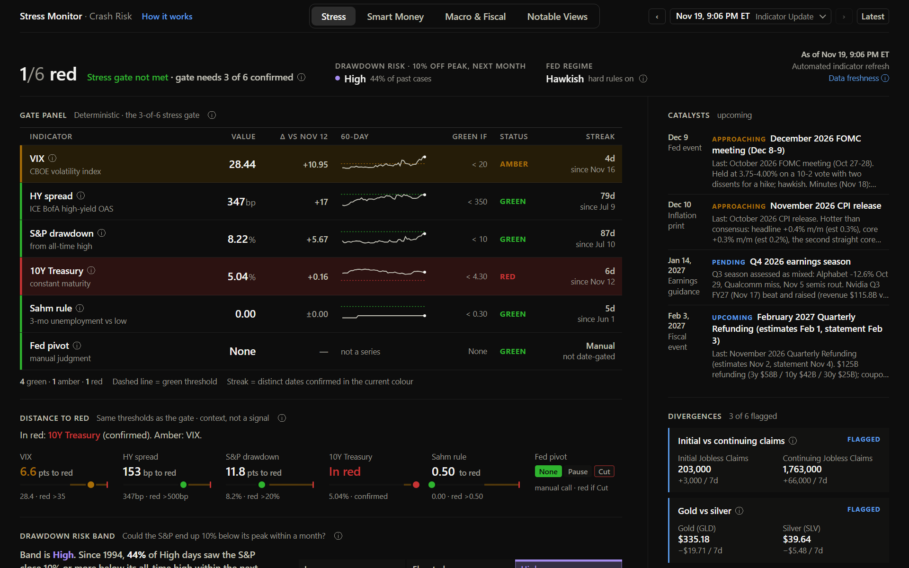
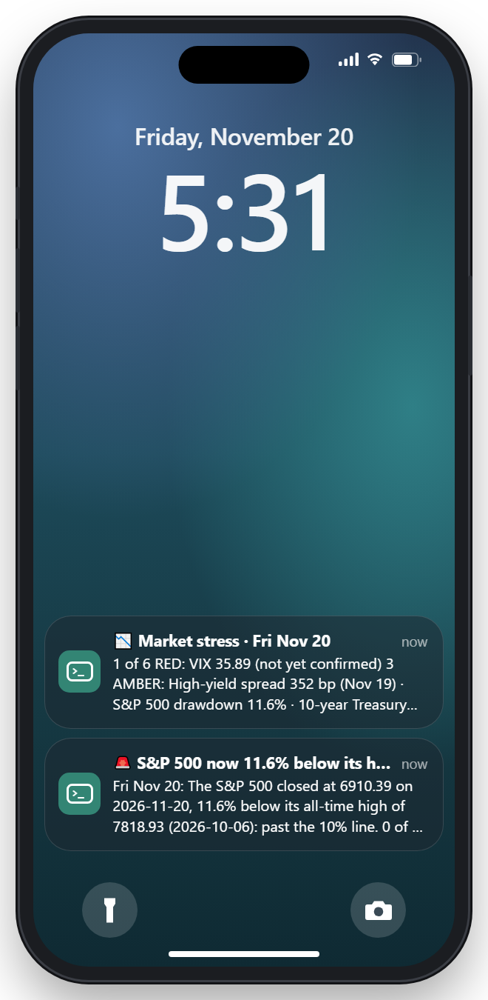
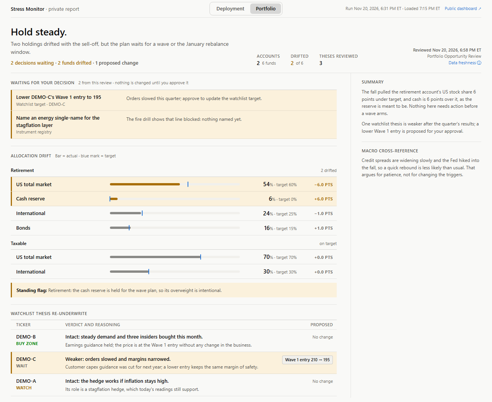
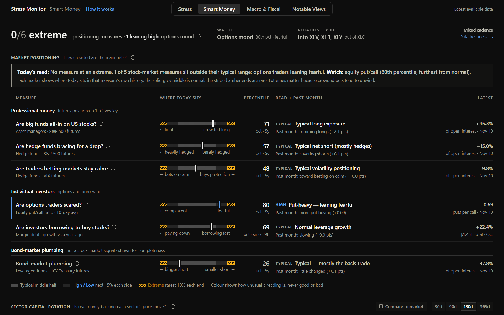
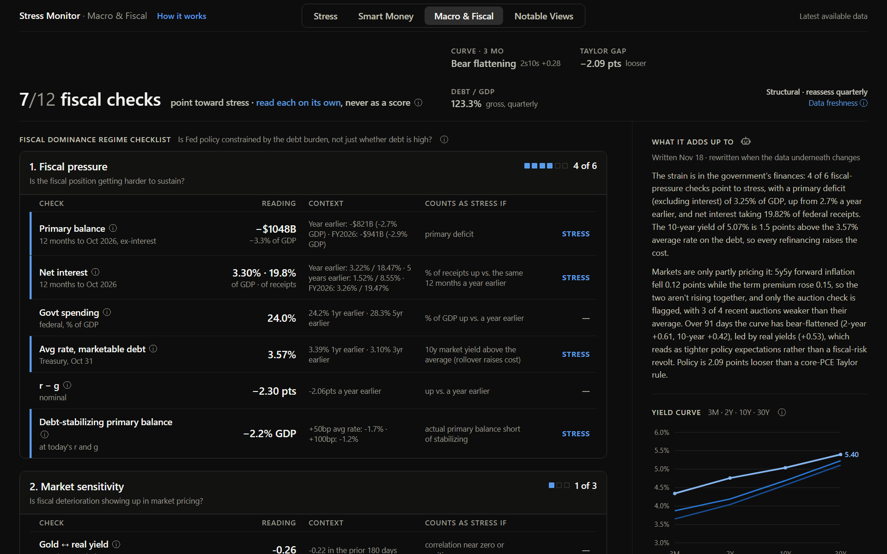
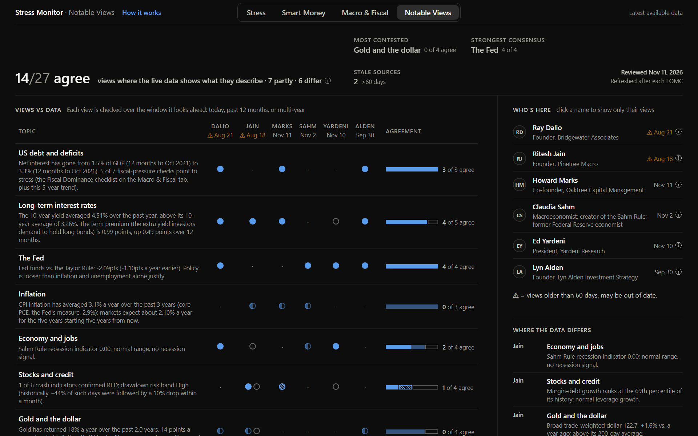
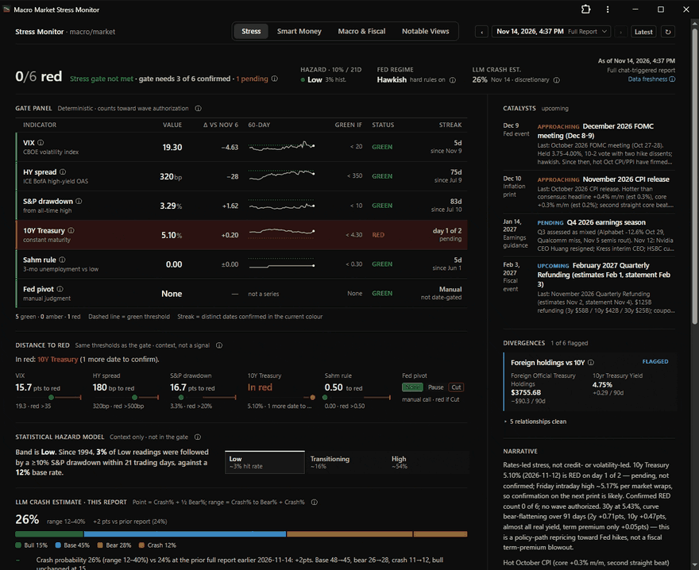
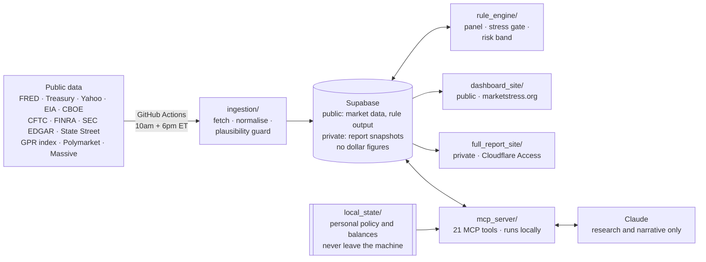

<div align="center">

# Macro Market Stress Monitor

**The LLM writes the story. The code makes the call.**

A daily market-stress and crash-risk monitor built on public data. A
deterministic TypeScript rule engine scores six crash indicators
RED / AMBER / GREEN. Claude, connected over MCP, does the research and writes
the narrative, and never re-derives a number.

[](https://github.com/abhay-sud/market-stress-monitor/actions/workflows/ingest.yml)
[](https://marketstress.org/)
[](https://github.com/abhay-sud/market-stress-monitor/commits/main)
<br>


**[Live dashboard →](https://marketstress.org/)** · free, no sign-up, updated daily<br>
**[Get the alerts on your phone →](docs/run-your-own.md)** · fork, add two secrets, done<br>
[How it works](#how-it-works) · [Evidence](#evidence-over-vibes) · [Rules](reference_docs/rules/crash-check-rules.md) · [Run it yourself](#run-it-yourself) · [Known gaps](BACKLOG.md)

<a href="https://marketstress.org/">
  
</a>

</div>

> [!WARNING]
> **Not investment advice.** This is a personal, educational project. The
> dashboard's bands, stress gate and crash probability apply the author's own
> rules to public data. They are not recommendations to buy or sell anything,
> and the data can be delayed, revised or wrong. The code is shared as-is,
> with no warranty.

## Get the alerts yourself

Fork this repo, add a free FRED key and an [ntfy](https://ntfy.sh/) topic as
secrets, and switch on GitHub Actions. Every weekday evening your phone gets
the reading, plus an alert when something changes. No server, no database,
no cost. Here is the reading for Friday 20 November 2026, on the lock screen
and opened in the app:

<p>
  
  &nbsp;
  
</p>

Same rules and code as the live site. Optional extras: your own crash-plan
triggers as a private secret (you get "Wave 2 trigger hit", never the
levels), Telegram/Discord/Slack/email, and a short AI summary from the
model of your choice, whose numbers are checked against the data before it's
sent. **[Ten-minute setup →](docs/run-your-own.md)**

## Your private layer: ask Claude about your own plan

The public site tells everyone the state of the market. The private layer
turns that into **your** plan, on your own computer. You write your crash plan
(when each "wave" of your cash reserve goes in, and where) and your target
allocation into two local files. Then you ask Claude:

<p align="center">
  
</p>

That is a real answer, from the [example files](local_state/my_plan.example.yaml)
and the market on Friday 20 November 2026. **The numbers come from code, not
from the model:** the server replays the same rules as the live site and does
the plan and drift arithmetic, and Claude only explains the result.

- **Which of your waves is armed**, by which pathway, since when, and how far
  the others are. The fast-panic pathway needs a drawdown plus a VIX level; the
  slow-bear pathway needs a drawdown held at a fresh one-year low.
- **What your plan says to deploy now**, in dollars if you give your cash
  reserve. It counts every armed wave you haven't marked done, so a crash that
  skips straight to Wave 2 brings Wave 1 back too.
- **Portfolio drift** against your targets, flagged by the 5/25 rule.
- **What changed** in the last few days, and any day's reading from the last
  two years.

It needs only a free FRED key and Node.js. It runs on your machine as a small,
read-only MCP server for Claude Desktop, Claude Code or any MCP client. There's
no database and no hosting, and it costs nothing beyond your own Claude plan.
Your files never leave your computer, except what Claude puts into the chat.
**[Set it up →](docs/run-your-own.md#ask-claude-about-your-plan-optional)**

### The full setup adds a private report

On top of the lightweight server, the full setup (Supabase, a scheduled Claude
run and a Cloudflare page behind a login) keeps a private report updated every
evening. The Deployment tab shows wave pathways, a fire drill of the plan (could
each line actually be bought today, through the main route or the backup?), a
watchlist priced against each wave's entry targets, and insider buying. The
weekly Portfolio tab shows drift, a re-underwrite of each watchlist thesis, and
a list of proposed changes that wait for your approval. The report never stores
a dollar figure.

<p align="center">
  <a href="docs/screenshots/private-report.png"></a>
  &nbsp;
  <a href="docs/screenshots/private-review.png"></a>
</p>

Example data throughout: the `DEMO` tickers and the fund names are made up.
See [AI workflows over MCP](#ai-workflows-over-mcp) and the
[security model](#security-model-public-engine-private-policy).

## Contents

- [Get the alerts yourself](#get-the-alerts-yourself)
- [Your private layer](#your-private-layer-ask-claude-about-your-own-plan)
- [Why this exists](#why-this-exists)
- [The dashboard](#the-dashboard)
- [How it works](#how-it-works)
- [What's deterministic and what's judgment](#whats-deterministic-and-whats-judgment)
- [Evidence over vibes](#evidence-over-vibes)
- [The indicators](#the-indicators)
- [AI workflows over MCP](#ai-workflows-over-mcp)
- [Security model: public engine, private policy](#security-model-public-engine-private-policy)
- [Tech stack](#tech-stack)
- [Run it yourself](#run-it-yourself)
- [Project structure](#project-structure)
- [Contributing, security and status](#contributing-security-and-status)

## Why this exists

It started as a giant static prompt: numbers hand-pasted into an LLM chat on
every run. That gave confident, unrepeatable answers. It became a small
pipeline built on three rules:

- **Numeric classification is never an LLM's job.** Every threshold, band and
  RED/AMBER/GREEN colour is computed by plain code from real market data. The
  LLM reads news, judges Fed communication and writes the narrative, and it
  always reports what the code already decided.
- **Every signal has to earn its place.** New flags are backtested for a base
  rate and a forward edge before they ship. Ideas that fail stay documented
  with their evidence, and features that turn out to be noise get deleted.
- **Personal data never leaves the machine.** The engine and the dashboard
  are public; the deployment policy and every dollar figure stay in local,
  gitignored files, with guardrails in code that refuse to publish them.

## The dashboard

[marketstress.org](https://marketstress.org/) has four read-only tabs, each
with its own URL:

| | |
|---|---|
| **[Stress](https://marketstress.org/)**: the six-indicator panel, the stress gate, distance to RED, the drawdown risk band, a 3-month scenario view, upcoming catalysts, divergence flags and indicator history charts with their bands. | **[Smart Money](https://marketstress.org/smart-money)**: futures positioning (CFTC), options put/call and margin debt as historical percentiles, sector capital rotation, and institutional 13F net buying by sector. |
|  |  |
| **[Macro & Fiscal](https://marketstress.org/macro)**: a fiscal dominance checklist, contextual indicators, the yield curve and rates decomposition, and a short AI-written summary that is only rewritten when the data underneath changes. | **[Notable Views](https://marketstress.org/views)**: what well-known macro voices are saying, set against today's data. Short attributed paraphrases with links and dates, reviewed by hand before publishing. |
|  |  |

You can browse past reports with a calendar picker, check each source's
freshness, and install the dashboard as a home-screen app (PWA).

<details>
<summary>Animated tour (recorded 2026-11-15)</summary>
<br>

</details>

## How it works



| Component | What it does |
|---|---|
| [`ingestion/`](ingestion/) | Pulls each source into Supabase. A plausibility guard quarantines implausible values before they're written, and a backfill script loads each series' full history. No LLM and no classification logic. |
| [`rule_engine/`](rule_engine/) | Pure functions: the six-indicator panel, confirmation windows, the stress gate, cross-indicator divergence flags and the drawdown risk band. Writes `crash_checks`. Also holds the "run your own" alerts copy (`src/lite/`), which replays the same per-day logic from public data with no database, and its lightweight MCP server (`npm run mcp`) that answers questions about your own plan from local files. Vitest suite. |
| [`mcp_server/`](mcp_server/) | Local stdio [Model Context Protocol](https://modelcontextprotocol.io/) server. 21 tools: workflow instructions, market state, context indicators, rules lookup, portfolio drift, watchlist, wave evaluation, deployment planning and fire drill, fund-filing watch, and write/persist tools. Runs locally because it's the only component that reads personal data. `node:test` suite. |
| [`dashboard_site/`](dashboard_site/) | Public static site on Cloudflare Pages, no build step. Reads only public market data with the anon key. A small worker server-renders the latest reading for crawlers and AI tools. |
| [`full_report_site/`](full_report_site/) | Private page behind Cloudflare Access: wave status, personal triggers, the watchlist with insider activity, crash-type diagnosis and the portfolio review. Rendered server-side, so no credential reaches the browser. |
| [`config/`](config/) | `monitoring.yaml`: the public panel bands, confirmation days and stress gate, read by both `rule_engine` and `mcp_server`. |
| [`supabase/migrations/`](supabase/migrations/) | Schema and row-level-security history. |

## What's deterministic and what's judgment

This is a stress-monitoring and discretionary deployment dashboard, **not a
calibrated crash-probability model**. Both reporting pages say so.

| Output | How it's produced | Validated? |
|---|---|---|
| Six-indicator panel, bands, confirmation windows, stress gate | Code (`rule_engine/`), thresholds in `config/monitoring.yaml` | Deterministic and reproducible |
| Deployment waves | Code (`mcp_server/`), triggers in a private local policy file | Deterministic. The pathways were replayed against every ≥20% S&P drawdown since 1993, but the thresholds are a personal choice, not an optimised fit |
| Drawdown risk band: could the S&P end up 10% below its peak within ~21 trading days? | Code: S&P drawdown % + VIX / 5, three bands | Yes, modestly. See [the results below](#results-the-drawdown-risk-band) |
| Scenario split and crash probability | A frozen historical bull/base/bear/crash split for the current risk band, which the LLM may tilt by one 5-point step | Partly: the split is history (a handful of crises); the tilt has no track record yet |
| Crash-type diagnosis, Fed classification | LLM judgment informed by the panel and web research | No |

The full write-up is in
[`crash-check-rules.md`](reference_docs/rules/crash-check-rules.md)
("What this system actually is").

## Evidence over vibes

How changes get made, and what's been thrown out along the way:

- **New signals are backtested before they ship.** A flag needs a base rate
  and a forward edge. Rejected so far, with the evidence kept: a MOVE-vs-VIX
  divergence flag, a BDC-ETF private-credit proxy, high-frequency positioning
  signals and a CTA trend-exposure estimate. See "Investigated and rejected"
  in the rules doc,
  [`BUILD_SPEC_crash_check_enhancements.md`](reference_docs/BUILD_SPEC_crash_check_enhancements.md)
  and the
  [hazard-model rebuild brief](reference_docs/hazard-model-rebuild-brief.md).
- **A model that couldn't beat a simple rule was retired.** A 32-input
  logistic hazard model looked strong in-sample. Refit honestly out of sample,
  it scored an AUC of 0.545 (a coin flip is 0.5) against 0.818 for a
  two-input drawdown + VIX rule, and three rebuilt variants also failed. The
  rule replaced it, and the model is still scored daily, side by side, so the
  record stays honest
  ([`hazard-model-rebuild-brief.md`](reference_docs/hazard-model-rebuild-brief.md)).
- **Rules that hurt in backtests are relaxed, in public.** Requiring the
  3-of-6 stress gate before deploying blocked six deployments since 1990 that
  were all up a year later, and never blocked one that lost (two
  pre-registered backtests on 1962–2026 data, reproduced by an independent
  reviewer). Since 2026-11-19 the gate is shown as information, not required.
- **An alert that never warned in time was replaced.** The original phone
  alert fired when 2 indicators were confirmed RED. Replayed over 1990–2026,
  it fired before the S&P was 10% down in none of the four bear markets, and
  a 10% fall followed it less often than an ordinary day. It was retired for
  an alert on the deployment triggers themselves
  ([`config/monitoring.yaml`](config/monitoring.yaml)).
- **Ideas that sound smart but don't pay are left out.** Tilting holdings by
  macro regime was tested before it could be built: instrument tilts added
  +0.14% a year (90% interval −0.76% to +0.96%) and industry tilts −0.49%,
  so the regime notes stay as context only (rules doc, "Regime → Instrument
  Fit").
- **Low-signal features get cut.** A discretionary "Risk Radar" score was
  retired, and later deleted, after its readings swung run to run on
  unchanged data.
- **Refactors are checked for identical behaviour.** Moving thresholds into
  config files and wave evaluation onto the local machine was verified by
  diffing old and new code over every input combination and the full real
  history before switching over.
- **External reviews are written down with their outcomes**
  ([`architecture-summary-for-external-review.md`](reference_docs/architecture-summary-for-external-review.md)).

### Results: the drawdown risk band

Score = S&P drawdown from its all-time high (%) + VIX / 5. The cutoffs were
fixed before any live scoring and are never retuned from live results.

| Band | Score | Share of days, 1994–2026 | S&P closed 10%+ below its peak within the next ~21 trading days |
|---|---|---|---|
| Low | below 8.5 | ~77% | 4.6% |
| Elevated | 8.5 to 10 | ~8% | 16.8% |
| High | 10 and above | ~15% | 44.4% |
| *All days* | | | *~12% base rate* |

Ranking skill (AUC): 0.834 in the 1994–2026 replay, 0.818 out of sample. The
live scorecard keeps recording each day's band against what actually
happened.

## The indicators

### The six-indicator panel and the stress gate

The panel tracks **VIX, HY credit spreads, S&P drawdown from its all-time
high, the 10-year Treasury yield, the Sahm Rule and a Fed-pivot signal**. A
RED reading only counts once it holds across two or more distinct ingestion
dates, so a single noisy print can't trigger anything. The **stress gate** is
met when 3 or more of the 6 are confirmed RED: a read on how broad the stress
is. All of these thresholds live in
[`config/monitoring.yaml`](config/monitoring.yaml).

### Deployment waves

A staged, three-tranche plan for deploying a cash reserve. A wave becomes
deployable when **its own trigger** holds: S&P drawdown from the all-time high
plus a VIX level (same day), or a separate "slow-bear" pathway (deep drawdown
plus a fresh one-year low, confirmed on two dates) for grinding,
low-volatility bears like 2000–02 and 2022, which the drawdown + VIX pathway
missed in backtesting. The stress gate is reported alongside; setting
`stress_gate_required: true` in the config makes it a requirement again.

Trigger levels and the percentage split of each wave are personal policy, so
they live in a gitignored local file, not in this repo. Waves are evaluated
on the local machine from public inputs the rule engine publishes (drawdown,
VIX, days since a one-year low). Deployment is cumulative and
execution-aware: a fast crash that skips straight to Wave 3 returns every
not-yet-executed wave, and executed waves are tracked locally so they're
never proposed twice.

### Context only (never gates)

- **Contextual indicators:** financial-conditions and stress indices (incl.
  the OFR FSI), breakevens, jobless claims, IG spreads, the yield curve and
  the NY Fed's recession-probability model, the SOFR−IORB repo-stress spread,
  MOVE bond volatility, Treasury auction quality, copper, recent-grad
  unemployment and more.
- **Distance to RED:** how far each panel indicator is from its RED band.
- **Divergence detection:** pairs that normally move together, flagged when
  they decouple: IG vs HY spreads, initial vs continuing claims, VIX vs HY,
  gold vs silver, and foreign official Treasury holdings vs the 10-year
  yield.
- **Positioning and flows:** CFTC Commitments of Traders, CBOE put/call and
  FINRA margin debt as historical percentiles; sector rotation; 13F
  institutional net buying by sector.
- **Fiscal dominance checklist:** Taylor-rule gap, primary balance, net
  interest as a share of GDP and of receipts, the average rate on marketable
  debt, and the gold/real-yield relationship.
- **Event-conditional scenarios** for scheduled events such as FOMC
  meetings, scored after the event.

## AI workflows over MCP

The MCP server works with any MCP client. Two workflows run on it:

- **"Run crash check"** runs every weekday evening as a headless Claude Code
  job, after the 6pm ingest. It confirms ingestion actually ran, pulls the
  panel and context, and commits to a scenario view **before** it can see the
  previous report's number. That anti-anchoring rule is enforced by tool
  order: no tool used in the first six steps exposes a prior probability. It
  then does the qualitative research, persists the result (`write_snapshot`
  for the public row, `write_full_report` for the private page) and ends with
  a plain-text summary. Steps:
  [`project-instructions.md`](reference_docs/rules/project-instructions.md).
- **"Run portfolio review"** runs weekly. It covers portfolio drift against
  targets, watchlist status, a deployment fire drill, fund-filing checks and
  a re-underwrite of each watchlist thesis. It's rendered from
  [`portfolio-review-template.html`](reference_docs/rules/portfolio-review-template.html)
  and merged into the private Full Report page. It only proposes changes;
  applying them is a manual step.

The instructions, the review template and the rules doc are served by the
MCP server itself (`get_instructions`, `get_rules`) straight from this
working tree, so a change takes effect on the next run without re-uploading
anything.

## Security model: public engine, private policy

Personal financial data never reaches a cloud service, and personal policy
never reaches the public repo or the public tables.

- **Three kinds of configuration.**
  - Public monitoring thresholds: [`config/monitoring.yaml`](config/monitoring.yaml).
  - Personal policy, local and gitignored: `local_state/policy.yaml` (wave
    triggers, wave and crash-type splits, hard rules, private terms) and
    `local_state/personal-rules.md` (the personal sections of the rules doc,
    merged in by the `get_rules` tool).
  - Dollar data, local and gitignored: balances, cash reserve, position
    sizing, executed waves, the exchange log.

  The repo tracks only `*.example.yaml` templates with illustrative numbers.
- **Two access tiers in Supabase.** `crash_checks` and `data_points` are
  readable with the public anon key, which is how the dashboard works; they
  hold market data, rule output and market-event triggers only. Everything
  personal, including the private report snapshots, watchlist ticker prices
  (`private_data_points`), the watchlist and its insider activity, is
  readable only with the server-side key that the local MCP server and the
  Access-gated Pages Function hold.
- **Guardrails in code, not just instructions.** Every write path that
  persists free text checks it against the real local portfolio and throws
  on any dollar figure. `write_snapshot` also refuses public text containing
  any of the policy's private terms (account names, "watchlist") and keeps
  only market-event triggers on the public row.
- **A leak guard on every push.** A dependency-free pre-push hook
  ([`.githooks/leak-guard.mjs`](.githooks/leak-guard.mjs)) checks each new
  commit's changes, file names, message and author against the personal
  terms, tickers, fund names and dollar figures in the gitignored local
  files, plus common secret patterns, and blocks the push on any hit. The
  sensitive lists are read at push time, so they never enter the repo.
- **Dollar amounts are computed at read time.** The policy stores wave
  splits as percentages of the cash reserve; the MCP server applies them to
  the local balance, and the result stays in the chat.

Found a problem with any of this? See [`SECURITY.md`](SECURITY.md).

## Tech stack

| Layer | What's used |
|---|---|
| Language and runtime | TypeScript, Node.js 22+ (three independent packages, no root workspace) |
| Scheduling | GitHub Actions cron (10am ET Mon–Sat, 6pm ET Mon–Fri; SEC 13F manual, quarterly) |
| Storage | Supabase Postgres with row-level security, two access tiers |
| Public site | Static HTML/JS on Cloudflare Pages, plus a small worker for server-rendered metadata |
| Private site | Cloudflare Pages Function behind Cloudflare Access |
| AI layer | Model Context Protocol server (stdio), Claude for research and narrative |
| Alerts | ntfy.sh push when a wave trigger fires (run locally); the "run your own" copy sends a daily brief and event alerts from GitHub Actions to ntfy, email, Telegram, Discord or Slack |
| Tests | Vitest (`rule_engine`), `node:test` (`mcp_server`), `tsc --noEmit` everywhere |

## Run it yourself

> **At your own risk.** The alerts-only copy below is packaged to run on its
> own; the full setup after it is one person's working system, not a product.
> If you only want to look at the signals, use the
> [live dashboard](https://marketstress.org/).

### Alerts only: your own copy in ten minutes

Get the six-indicator reading every weekday evening and an alert when
something changes, on your phone (ntfy, Telegram, Discord, Slack or email).
Fork the repo, add a free FRED key and one notification secret, and switch on
GitHub Actions. No database, no website, nothing to install. You can also add
your own wave triggers and get a private alert when one is hit. Same rules and
code as the live site.

**[Set it up: docs/run-your-own.md](docs/run-your-own.md)**

### Quick look: no keys, no accounts

The rule logic is pure functions with tests, so you can read and run it
without any credentials:

```bash
git clone https://github.com/abhay-sud/market-stress-monitor.git
cd market-stress-monitor/rule_engine
npm ci
npm test          # Vitest: bands, confirmation, stress gate, risk band, scorecards
cd ../mcp_server
npm ci
npm test          # node:test: deployment instruments, trading limits, filings, scenario tilt
```

Tests use `local_state/policy.example.yaml`, never a real policy.

### Full setup

You'll need your own Supabase project, Cloudflare Pages, GitHub Actions,
several free API keys and an MCP client such as Claude Desktop or Claude
Code. Requires Node 22+. Each of `ingestion/`, `rule_engine/` and
`mcp_server/` is an independent package (`npm ci` inside each) with a
`.env.example` to copy to `.env`:

| Variable | Needed | What it's for |
|---|---|---|
| `SUPABASE_URL`, `SUPABASE_SERVICE_ROLE_KEY` | Yes | Your Supabase project |
| `FRED_API_KEY` | Yes | Free, [fred.stlouisfed.org](https://fred.stlouisfed.org/docs/api/api_key.html) |
| `EIA_API_KEY` | Yes | Free, [eia.gov/opendata](https://www.eia.gov/opendata/) |
| `MASSIVE_API_KEY` | For watchlist prices | Free tier at massive.com |
| `SEC_EDGAR_CONTACT_EMAIL` | For SEC data | SEC requires a contact address in automated requests |
| `POLYMARKET_SLUGS` | Optional | Polymarket markets to track |
| `NTFY_TOPIC` | Optional | A random, unguessable ntfy.sh topic for the local wave-trigger alert (`mcp_server`, not GitHub Actions) |

Then:

1. Copy each `local_state/*.example.yaml` to the same name without
   `.example` and fill in your own values, starting with `policy.yaml`
   (your wave triggers and splits) and `portfolio.yaml`. Optionally add a
   `local_state/personal-rules.md` with your own versions of the rules
   doc's personal sections, under the same headings.
2. Tune [`config/monitoring.yaml`](config/monitoring.yaml) if you want
   different bands or a different stress gate.
3. Apply `supabase/migrations/` in order (SQL editor or Supabase CLI).
4. Add the same values as GitHub Actions secrets for
   `.github/workflows/ingest.yml`. Run `backfill.yml` once to load history.
5. MCP client: merge
   [`mcp_server/claude_desktop_config.example.json`](mcp_server/claude_desktop_config.example.json)
   into your config (the MCP server needs `PORTFOLIO_PATH` and
   `WAVE_DEPLOYMENT_STATE_PATH`; the other local files default to sitting
   next to `PORTFOLIO_PATH`). In Claude Desktop, create a project and set its
   instructions to one line: *"Before anything else, call the crash-check
   `get_instructions` tool and follow what it returns."* Attach nothing as
   project knowledge.
6. `dashboard_site/`: a Cloudflare Pages project with no build step. Swap
   in your own Supabase URL and anon key.
7. `full_report_site/`: a second Pages project behind Cloudflare Access.
   See [`full_report_site/README.md`](full_report_site/README.md).

`npm run typecheck` works in all three packages.

If you keep personal data in `local_state/` and push to a public fork, turn
on the leak guard once per clone: `git config core.hooksPath .githooks`,
then copy `local_state/leak-guard.example.yaml` to `leak-guard.yaml` and
add your own name and email.

## Project structure

```
ingestion/            data sources → Supabase, plausibility-guarded
rule_engine/          deterministic panel, stress gate, risk band; src/lite/ = run-your-own alerts + lightweight MCP
mcp_server/           local MCP tools (21), wave evaluation, wave-trigger alert
dashboard_site/       public dashboard (static, Cloudflare Pages)
full_report_site/     private Full Report page (Cloudflare Pages Function)
config/               public monitoring thresholds
reference_docs/rules/ rules doc, workflow instructions, review template
reference_docs/       hazard-model explainer and rebuild brief, external-review summary, specs
supabase/migrations/  schema + row-level security
local_state/          *.example.yaml templates; real files are gitignored
docs/                 run-your-own setup guide, screenshots and demo
.github/workflows/    daily ingest + classify, backfill, SEC 13F, run-your-own alerts
```

## Contributing, security and status

- **Contributing:** questions, data issues and ideas are welcome. See
  [`CONTRIBUTING.md`](CONTRIBUTING.md) for what helps most and how new
  signals are judged.
- **Security:** please don't open a public issue for a vulnerability. See
  [`SECURITY.md`](SECURITY.md).
- **Conduct:** [`CODE_OF_CONDUCT.md`](CODE_OF_CONDUCT.md).
- **Known gaps:** [`BACKLOG.md`](BACKLOG.md) lists open items, deliberately
  deferred rather than forgotten.
- **Data sources:** each source (FRED and the series' original providers,
  Treasury, EIA, CBOE, CFTC, FINRA, SEC EDGAR, State Street, Polymarket,
  Yahoo Finance, Massive) keeps its own terms, and you're responsible for
  complying with them when you run the code with your own keys.
- **Status and support:** a personal project with a single maintainer,
  shared as-is and maintained as time allows. It runs daily and is actively
  used. Issues are for bugs and data problems; pull requests are welcome but
  may not be merged. There's no support commitment, and responses aren't
  guaranteed.

## License

The code is released under the [MIT License](LICENSE). The license covers this
repository's code only: market data from FRED, ICE, Treasury, Yahoo Finance
and the other sources (including values in test fixtures) keeps its owners'
terms. Nothing here is investment advice.
